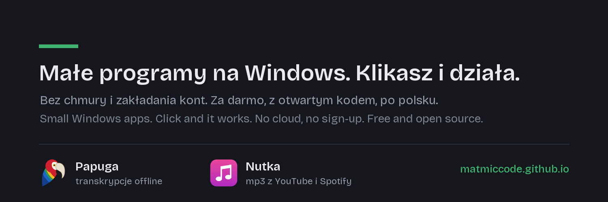

## MATCODE

Moje narzędzia na PC. Instalujesz i działają. Bez chmury i zakładania kont.
Za darmo, z otwartym kodem, po polsku.

*My PC tools. Install them and they just work. No cloud, no sign-up. Free and open source.
The interface is Polish for now, English is on the way.*

**[matmiccode.github.io](https://matmiccode.github.io/)** – wszystkie programy w jednym miejscu.

| | | |
|:--|:--|:--|
|  | **[Papuga – transkrypcje offline](https://matmiccode.github.io/papuga/)** Zamienia nagrania w tekst i rozpoznaje, kto mówi. Windows 10 i 11. | [Pobierz](https://github.com/matmiccode/papuga/releases/latest) · [Kod](https://github.com/matmiccode/papuga) |
|  | **[Nutka – mp3 i filmy z YouTube, playlisty ze Spotify](https://matmiccode.github.io/nutka/)** Wpisz tytuł albo wklej link i dostajesz mp3 z okładką albo film mp4. Pobiera też playlisty ze Spotify. Windows 10 i 11. | [Pobierz](https://github.com/matmiccode/nutka/releases/latest) · [Kod](https://github.com/matmiccode/nutka) |

[Postaw kawę autorowi](https://buycoffee.to/matcode)
